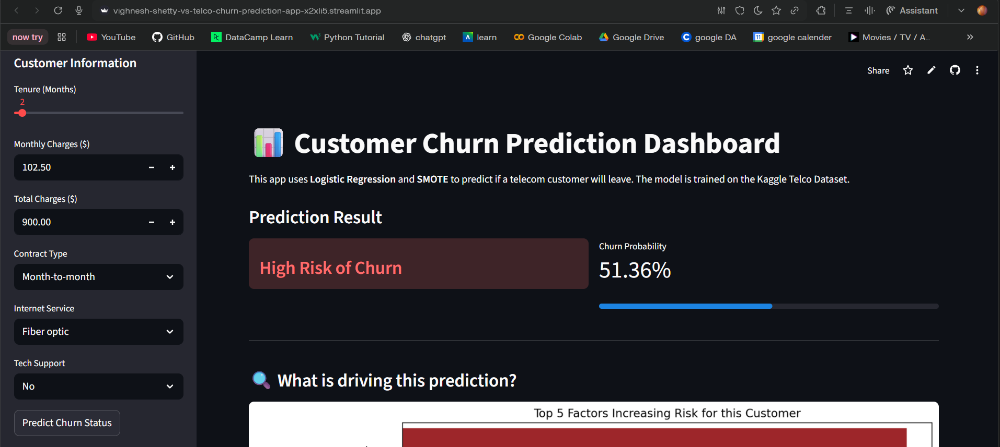
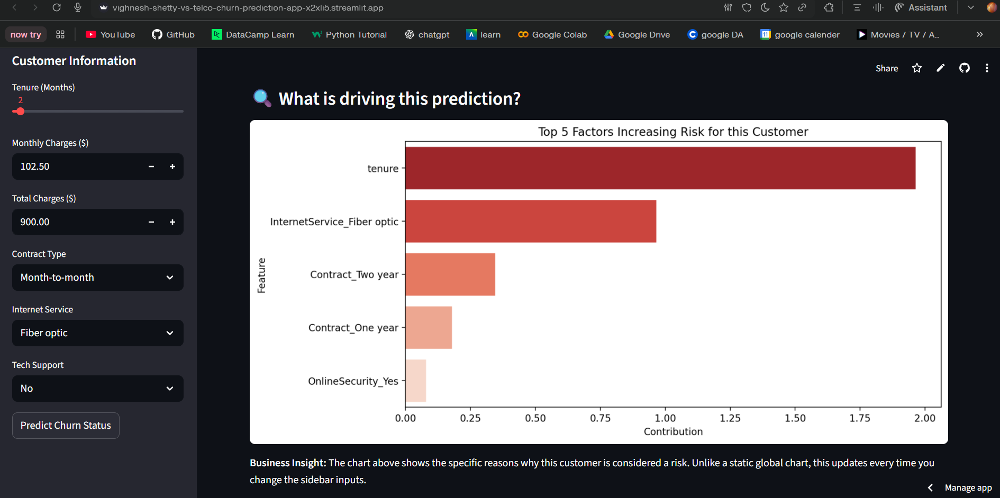
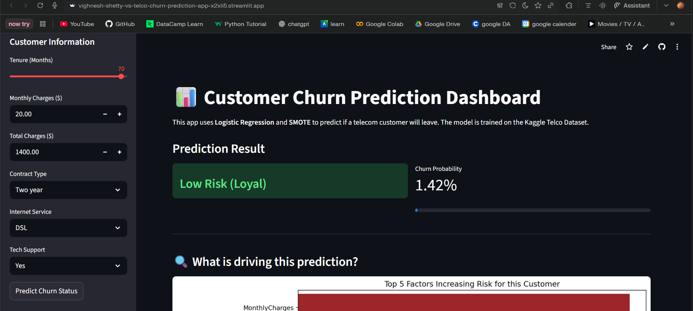
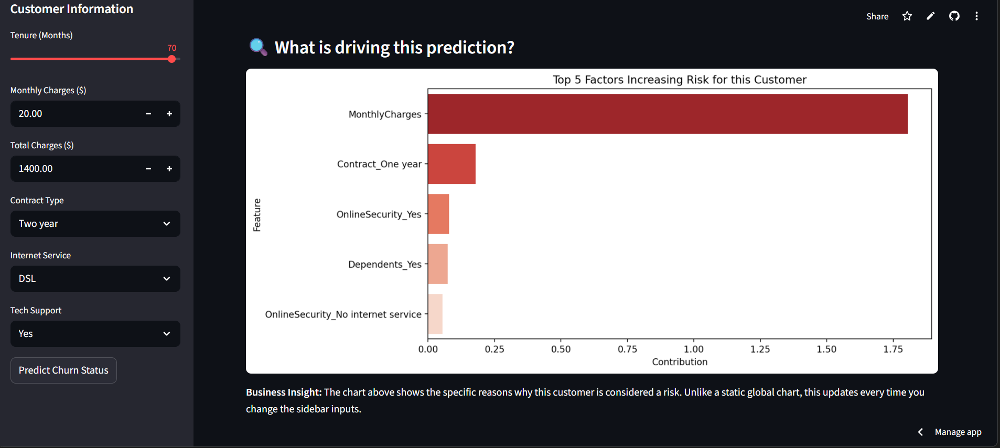

📊 Telco Customer Churn AI Predictor

Live App: https://vighnesh-shetty-vs-telco-churn-prediction-app-x2xli5.streamlit.app/

This project implements an end-to-end Machine Learning solution to predict customer churn for a telecommunications company. It uses Logistic Regression optimized with SMOTE (Synthetic Minority Over-sampling Technique) to handle class imbalance, providing a functional Streamlit dashboard for real-time predictions.

🎯 Business Case
In the telecom industry, acquiring a new customer is 5–25 times more expensive than retaining an existing one.

Objective: Identify high-risk customers before they leave.

Key Metric: Recall (capturing as many actual churners as possible) and Churn Probability.

Actionable Insight: The business can use these predictions to offer targeted discounts or loyalty programs to "At-Risk" individuals.

🛠️ Technical Stack
Python 3.10+

Machine Learning: Scikit-Learn (Logistic Regression)

Imbalance Handling: Imbalanced-Learn (SMOTE)

Web Framework: Streamlit

Data Manipulation: Pandas & NumPy

🚀 Features
Automated Pipeline: Data cleaning and encoding are handled automatically upon startup.

Class Imbalance Correction: Uses SMOTE to synthesize new examples of the minority class (churners), significantly improving the model's ability to detect churn.

Interactive UI: A sidebar-driven interface allows users to input customer attributes and see immediate risk scores.

## 🔍 Model Interpretability (Explainable AI)
A key feature of this dashboard is the **Dynamic Feature Importance** chart. Unlike static models, this dashboard provides a local explanation for every single prediction. 

* **Global Insight:** The model identifies that long-term contracts and low monthly charges generally reduce churn.
* **Local Insight:** For an individual customer, the app calculates exactly how much their specific attributes (e.g., high Fiber Optic costs) contributed to their risk score.

> **Business Value:** This allows customer success teams to see not just *who* might leave, but *why*, enabling personalized retention strategies (e.g., offering a contract upgrade if 'Month-to-month' is the primary churn driver).

## 📈 Evaluation and recommendations

`python evaluate.py` compares the app's model with a simple business rule and two alternatives on the same 20% test set (1,407 customers, 26.6% churn). Full output: [reports/metrics.md](reports/metrics.md).

| Model | Recall | Precision | F1 | ROC-AUC |
|---|---|---|---|---|
| Rule: flag every month-to-month customer | 87.2% | 41.4% | 0.561 | |
| Logistic regression, no rebalancing | 51.6% | 62.1% | 0.564 | 0.832 |
| **Logistic regression + SMOTE (this app)** | **79.7%** | **50.2%** | **0.616** | 0.832 |
| Logistic regression, `class_weight='balanced'` | 79.1% | 49.7% | 0.610 | 0.832 |

**What this shows:**
- **SMOTE doesn't make the model better at ranking customers.** ROC-AUC is identical, so all it does is move the decision threshold towards recall. `class_weight='balanced'` gets the same result without generating synthetic rows, and it's simpler to run in production.
- **The model beats the obvious rule.** The rule finds more churners but wastes 59% of retention offers on loyal customers.
- **Targeting works.** The riskiest 20% of customers contain 50% of all churners, and the riskiest 30% contain 65%.

**Recommendations for the retention team:**
1. **Start with month-to-month fibre customers:** 2,128 customers with a 54.6% churn rate, the largest high-risk group. Offer a discounted one-year contract. One-year fibre customers churn at 19.3%.
2. **Focus on the first year.** Tenure is the strongest protective factor, so onboarding and early-life offers matter more than late retention.
3. **Budget by score, not by segment.** Contacting the top 30% by model score reaches about two thirds of churners.

**Caveats:**
- TotalCharges is roughly tenure × MonthlyCharges. Because of that overlap, the MonthlyCharges coefficient comes out negative, which isn't believable on its own. Read the drivers as a group, not one by one.
- This is a single random split. Cross-validation would give a confidence band on these numbers.

💻 How to Run Locally
1. Clone the Repository
Bash

git clone https://github.com/vighnesh-shetty-vs/Telco-Churn-Prediction.git
cd Telco-Churn-Prediction
2. Set Up Environment
PowerShell

# Create virtual environment
python -m venv venv

# Activate (Windows)
.\venv\Scripts\activate

# Install dependencies
pip install -r requirements.txt
3. Launch the App
PowerShell

streamlit run app.py
📈 Model Performance
Because business data is often imbalanced, we prioritized Recall over simple Accuracy.

Without SMOTE: The model often ignores churners because they are the minority.

With SMOTE: The model "learns" the patterns of churners more effectively, leading to a higher detection rate of at-risk customers.

📁 Project Structure
Plaintext

├── data/
│   └── WA_Fn-UseC_-Telco-Customer-Churn.csv  # Kaggle Dataset
├── app.py                                   # Main Streamlit Application
├── requirements.txt                         # Dependencies
└── README.md                                # Project Documentation
